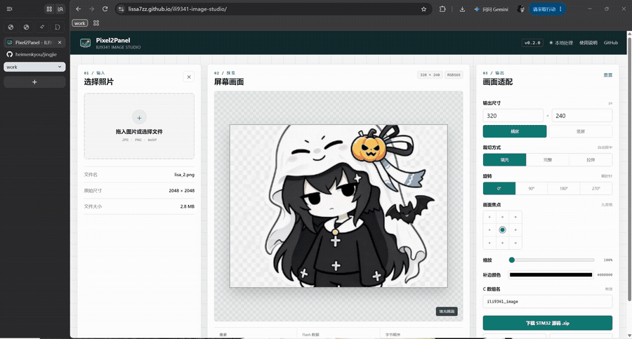
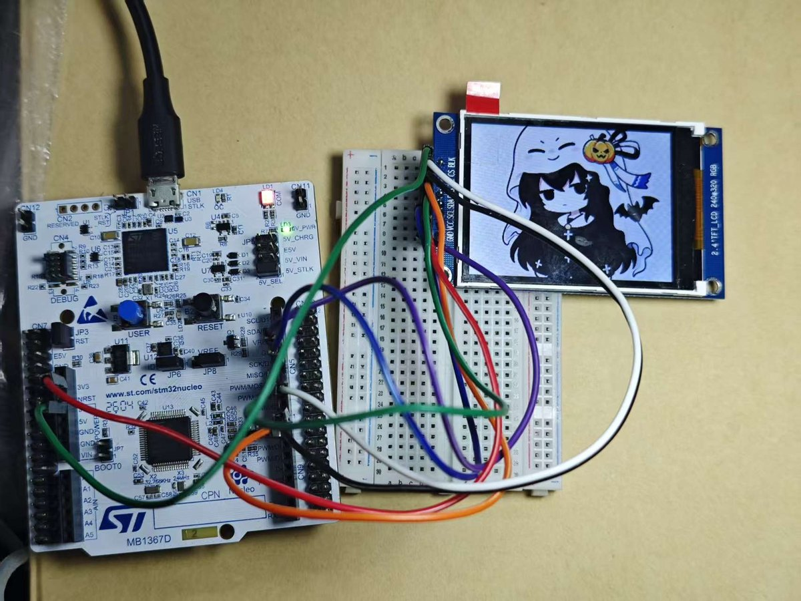

[English](README.md) | [简体中文](README.zh-CN.md)

[](https://github.com/Lissa7zz/ili9341-image-studio/actions/workflows/ci.yml)

**[快速入口 / Quick access: Open Pixel2Panel online](https://lissa7zz.github.io/ili9341-image-studio/)**

# Pixel2Panel

Pixel2Panel is a browser-based image preparation tool for STM32 and ILI9341
displays. Drop in an image, fit it to the display dimensions, convert it to
RGB565, and download a C header that can be added directly to an STM32 project.

All image processing happens locally in the browser. Images are not uploaded
to a server.

## Demo

[](assets/demo.gif)



## Download for Windows

The latest release provides:

- `.msi` installer
- NSIS `.exe` installer
- Single-file portable `.exe`
- `SHA256SUMS.txt`

[Download the latest Windows release](https://github.com/Lissa7zz/ili9341-image-studio/releases/latest)

Windows 10 and Windows 11 normally include Microsoft WebView2. The portable
EXE uses local image processing and requires no network connection.

## Features

- JPG, PNG, WebP, and BMP input
- Cover, contain, and stretch fitting modes
- Three-by-three focus control, zoom, rotation, and custom dimensions
- Paired RGB565 `.h` and `.c` source export
- Raw RGB565 `.bin` export
- 256 x 256 PNG-backed `.ico` project icon export
- No runtime dependencies and no backend
- Optional native Windows desktop build

## Quick start

Node.js 18 or newer is required.

```bash
npm start
```

Open `http://127.0.0.1:4173`.

The page uses ES modules, so access it through a local server instead of
opening `index.html` directly.

Windows users can also run `start.bat`. It starts the local server and opens
the browser.

### Windows desktop development

```bash
npm ci
npm run desktop:dev
```

Build the Windows installers and portable executable with:

```bash
npm run desktop:build
npm run release:prepare
```

The prepared files are written to `release-assets/`.

## Export format

The default output is `320 x 240` RGB565. The download contains a ZIP with a
declaration header and a matching source file. Each pixel uses two bytes with
the high byte first. This matches STM32 little-endian `uint16_t` storage and
the byte order used by the included ILI9341 driver.

Add both generated files to the STM32 project:

- `photo_rgb565.h` declares the image, dimensions, and data size.
- `photo_rgb565.c` contains the RGB565 bitmap.

The generated source can be passed directly to `ILI9341_DrawRGB565Image()`:

```c
#include "photo_rgb565.h"

ILI9341_DrawRGB565Image(
    photo_rgb565,
    PHOTO_RGB565_DATA_SIZE,
    PHOTO_RGB565_WIDTH,
    PHOTO_RGB565_HEIGHT);
```

A full-screen `320 x 240` RGB565 image contains:

```text
320 * 240 * 2 = 153,600 bytes
```

## Development

```bash
npm test
npm run test:e2e
npm start
```

Core encoding logic is in `src/core.js`. Browser interaction and Canvas
rendering are in `src/app.js`.

Unit and DOM tests use Node's test runner and jsdom. Chromium tests use
Playwright at desktop and mobile viewports. The production page has no runtime
dependencies.

## Roadmap

- Batch image processing and multi-image slideshow headers
- Compressed formats loaded from external SPI Flash
- More precise drag positioning and comparison previews
- Generated STM32 example projects

## Third-party references

The workflow was informed by the following online tools. This project does
not call their servers or APIs:

- Photopea: image editing and resizing
- AppShot ICO: project icon generation
- Image to RGB565 Converter: RGB565 conversion

## Developer

- Developer: Lissa7zz
- AI collaboration: OpenAI Codex
- Contact: [millergordon72@gmail.com](mailto:millergordon72@gmail.com)

## License

Copyright (C) 2026 Lissa7zz

This project is released under the [MIT License](LICENSE). You may copy,
modify, and distribute the project under its terms.

The software is provided "AS IS", without any express or implied warranty.
Third-party components remain subject to their respective licenses.

---

<p align="center"><em>كأن قلبي لم يعد ينبض؛ والريح الباردة تطلق تنهداتها — سانتاباد.</em></p>
